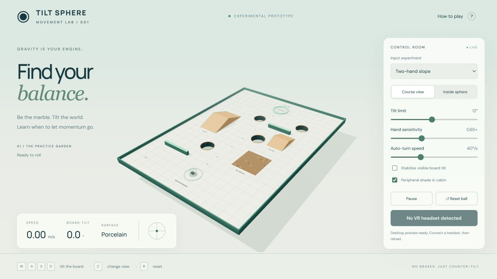

# Tilt Sphere / Movement Lab 001

A first experimental WebXR gravity maze. The outer sphere rolls; the inner cabin stays upright and smoothly faces actual velocity. Two controller experiments share the same physics. This is an authored prototype, not a native Quest APK.

## Play

**[Play Tilt Sphere](https://jmarshal1974.github.io/tilt-sphere/)**

On Quest 3, open the play link in the headset's browser and select **Enter VR**. No APK, PC connection, or GitHub login is needed to play the public build. Start seated with both controllers level. Headset behavior and comfort have not yet been verified on real hardware.

## Give feedback

This first build is for movement experiments. Try a tiny tilt, level your hands to coast, then counter-tilt to stop. Compare **Two-hand slope** and **Independent knobs** with X. We are most interested in whether the direction feels intuitive, whether slowing down is predictable, and whether automatic turning is comfortable.

Use the repository's **Issues** tab to report feedback. Include your control mode, tilt limit, sensitivity, turn speed, stabilization setting, headset/browser, and what happened. The game does not collect or transmit feedback automatically.

For the local desktop version, install Node.js if needed, then double-click **Launch Game.cmd**. Alternatively run `npm start` from this folder and open http://127.0.0.1:8787. All game libraries are included locally; only the optional UI fonts use Google's font service. There is no package installation step.

Directly opening index.html as a file will not load ES modules. Use the launcher or HTTPS build.

## Desktop controls

- WASD / arrows: board tilt in fixed course coordinates. Up/W always tilts toward the far end of the course, even after the cabin turns.
- Release: return the board to level. Momentum continues.
- Opposite direction: slow, stop, then reverse. There is no gameplay brake.
- C: course/cabin view. Drag the scene in cabin view to look around independently of automatic turning.
- R: reset sphere. Space: pause, preserving velocity.
- Settings: hard tilt limit, hand sensitivity, maximum automatic turning rate, visible tilt stabilization, peripheral shading.

Keyboard control is a physics/debug surrogate. It does not simulate two hands or controller orientations.

## Quest controller experiments

Start comfortably seated, looking toward the intended forward direction. The first tracked headset pose establishes a neutral cabin origin and heading. Physical head motion remains free. Use the left stick click to recenter after changing posture.

**Two-hand slope:** The horizontal vector between hands gives an axis. Height difference makes the board slope from the higher hand toward the lower. Equal heights level it. Stagger the hands in depth for forward/backward motion. There is an 18 mm height deadzone, a 14 cm minimum horizontal separation, 160 ms smoothing, and a radial hard tilt limit. The mapping uses the calibrated tracking frame, not the automatically turning cabin frame.

**Independent knobs:** Hold both grip buttons. Each grip captures its controller's current orientation as neutral. Left controller nose down/up controls forward/back tilt. Right controller roll controls right/left tilt. Release either grip to return to level, then regrip to establish a new neutral. These are clutched orientation controls, rather than spatially anchored knobs that require reaching for an object.

Standard WebXR gamepad mapping:

- Left X: switch experiments.
- Left thumbstick click: recenter headset/cabin origin and input heading.
- Right A: reset sphere and recenter.
- Right B: pause/resume.
- Losing a controller pose levels the board; it does not remove momentum. Losing headset tracking also levels the input. When the XR session loses visibility, simulation pauses until resumed with B.

## Practice garden

The 32 × 44 m platform has four open holes, two triangular ramps, two collision barriers, outer rails, a mud patch, and a mint goal. The goal registers after remaining inside it below 0.6 m/s for 0.65 seconds. A hole produces a fade and return to start. The ramps and mud are optional; the open layout deliberately supports free experimentation.

## Model and limitations

`physics.js` is the production movement model used by both desktop and XR. It runs at a fixed 120 Hz and transforms gravity into board coordinates. Grounded acceleration projects gravity onto the contact plane and uses a solid-sphere rolling factor of 5/7. Airborne motion uses gravity without that factor. Floor resistance is low (0.012 m/s²); mud has a 1.05 m/s² start threshold and additional speed-dependent resistance. Collision bounce is modest.

This is a purpose-built sphere/height-field model, not a general rigid-body engine. Ramp tops use a height field; ramp sides and barriers use sphere/box contacts. Hole support is center-based with a small rim tolerance: there is no detailed rim balancing or sphere wedging yet. Sharp ramp crests, high-speed impacts, and collisions during world-tilt transitions need headset and playtesting. Rotating the visual board does not add platform angular velocity to the sphere: world tilt changes gravity instead. No artificial speed cap is applied.

Cabin yaw follows horizontal board-local velocity above 0.12 m/s, capped at 40°/s by default. Zero turn speed disables automatic yaw. The inner cabin has no pitch/roll; the shell rolls independently. Display stabilization keeps the board visually level while retaining tilt-driven physics. Peripheral shading is an experimental static overlay, not a clinically validated comfort measure.

Actual Quest performance, controller ergonomics, stereo appearance, tracking recovery, and comfort remain unverified. Browser rendering and automated physics checks cannot establish those properties.

## Iterate

Run `npm test` for movement tests. Run `npm run build` to refresh the static `dist/` and `docs/` folders after changes. GitHub Pages serves the committed `docs/` folder from `main`; commit the updated `docs/` alongside source changes to update the playable build. The HTML/CSS and Three.js scene are deliberately separate from movement math.

Suggested first headset pass: leave tilt at 12°, keep both hands level, apply a tiny tilt for one second, level, then counter-tilt. Judge whether direction, momentum, and auto-turn feel predictable. Compare hands and knobs before adding obstacles or tuning speed. Record tilt limit, sensitivity, turn speed, display stabilization, and what felt wrong for each pass.

For a separate trusted local HTTPS setup, the included server accepts `--host`, `--port`, `--cert`, and `--key`. Bind to a LAN interface only if deliberately testing over your local network. Plain HTTP over a LAN is not a substitute for the secure context WebXR requires. See [MDN WebXR session setup](https://developer.mozilla.org/en-US/docs/Web/API/WebXR_Device_API/Startup_and_shutdown).

## Source map

- `game.js`: scene, visuals, fixed-step loop, XR poses, calibration, knobs, cabin and UI.
- `physics.js`: two-hand mapping, course data, movement, collision, goal and yaw math.
- `index.html` / `style.css`: desktop experiment panel.
- `server.mjs`: loopback-only local server by default; optional supplied HTTPS credentials.
- `tests/physics.test.mjs`: meaningful movement and input regressions.
- `vendor/`: Three.js r186, MIT licensed. See THIRD_PARTY.md.

No paid services or generated asset purchases are required by the game.
